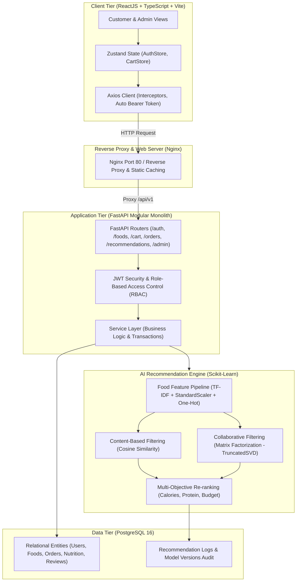

# Online Food Ordering System Integrated with AI Food Recommendation System

> **Dự án Nghiên cứu Khoa học Sinh viên (NCKH)**  
> **Tên tiếng Việt**: Xây dựng hệ thống đặt đồ ăn trực tuyến tích hợp hệ thống gợi ý món ăn đa mục tiêu theo dinh dưỡng và ngân sách.

[](https://www.python.org/)
[](https://fastapi.tiangolo.com/)
[](https://react.dev/)
[](https://www.typescriptlang.org/)
[](https://www.postgresql.org/)
[](https://scikit-learn.org/)
[](https://www.docker.com/)
[](https://github.com/)

---

## 1. GIỚI THIỆU ĐỀ TÀI

Hệ thống đặt đồ ăn trực tuyến kết hợp công nghệ **Trí tuệ nhân tạo (AI) / Machine Learning** nhằm giải quyết hai bài toán cốt lõi:
1. **Quá tải lựa chọn (Information Overload)**: Giúp người dùng nhanh chóng tìm được món ăn phù hợp với khẩu vị cá nhân.
2. **Cân đối Dinh dưỡng & Ngân sách (Multi-objective Recommendation)**: Tự động điều chỉnh thứ hạng món ăn dựa trên mục tiêu Calorie nạp vào, hàm lượng Protein (hỗ trợ tập gym/tăng cơ), ngân sách chi tiêu và các chế độ ăn đặc thù (ăn chay, eat-clean, keto).

---

## 2. KIẾN TRÚC TỔNG THỂ HỆ THỐNG (SYSTEM ARCHITECTURE)

Hệ thống được thiết kế theo mô hình **Modular Monolith** kết hợp **Clean Architecture** và **Separation of Concerns (SoC)**:



---

## 3. THỰC NGHIỆM KHOA HỌC: AI RECOMMENDATION ENGINE

Hệ thống triển khai và so sánh khách quan 3 thuật toán gợi ý trên cùng một tập dữ liệu thực nghiệm gồm **60 món ăn**, **120 người dùng thuộc 5 Persona ẩm thực**, và **2.798 lượt tương tác** (phân chia 80% Train, 20% Test phân tầng):

### Bảng kết quả đánh giá thực nghiệm (Offline Evaluation Benchmark):

| Thuật Toán (Algorithm) | Precision@5 | Recall@5 | F1@5 | NDCG@5 | MAP@5 | Precision@10 | Recall@10 | F1@10 | NDCG@10 | MAP@10 | Coverage@10 |
| :--- | :---: | :---: | :---: | :---: | :---: | :---: | :---: | :---: | :---: | :---: | :---: |
| **Popularity Baseline** | 0.1224 | 0.3135 | 0.1674 | 0.2245 | 0.1544 | 0.0991 | 0.4394 | 0.1565 | 0.2821 | 0.1810 | 38.33% |
| **Content-Based Filtering** | 0.1845 | 0.3407 | 0.2323 | 0.3237 | 0.2460 | 0.1405 | 0.5348 | 0.2173 | 0.4039 | 0.2897 | 100.00% |
| **Collaborative Filtering (SVD)**| 0.2259 | 0.4818 | 0.2924 | 0.4400 | 0.3606 | 0.1716 | 0.6948 | 0.2669 | 0.5321 | 0.4130 | 100.00% |
| **Hybrid RecSys (Multi-Objective)**| **0.2724** | **0.5703** | **0.3534** | **0.5147** | **0.4171** | **0.1871** | **0.7519** | **0.2914** | **0.5945** | **0.4683** | **100.00%** |

> **Điểm nổi bật**:
> - **Mô hình Hybrid** đạt thứ hạng cao nhất: $\text{NDCG@10} = \mathbf{0.5945}$ (tăng **$+110.7\%$** so với Baseline và **$+11.7\%$** so với CF thuần túy).
> - **$\text{Recall@10} = \mathbf{0.7519}$**: Tìm kiếm chính xác hơn $75\%$ các món ăn mà người dùng thực sự yêu thích trong tập kiểm thử.
> - **$\text{Coverage@10} = \mathbf{100\%}$**: Loại bỏ hoàn toàn hiệu ứng bong bóng lọc (Filter Bubble) của Baseline ($38.3\%$).

---

## 4. TECH STACK

- **Frontend**: ReactJS 18, TypeScript 5, Vite 6, Tailwind CSS, shadcn/ui, TanStack Query, Zustand, Axios, React Hook Form, Zod.
- **Backend**: Python 3.12+, FastAPI, SQLAlchemy 2.x, Pydantic 2.x, Alembic, PostgreSQL 16, PyJWT, bcrypt.
- **Machine Learning**: Pandas, NumPy, Scikit-learn, SciPy, Joblib (TF-IDF, StandardScaler, Cosine Similarity, TruncatedSVD).
- **DevOps & Testing**: Docker, Docker Compose, Nginx, pytest, Starlette TestClient.

---

## 5. HƯỚNG DẪN KHỞI CHẠY TỪ ĐẦU TRÊN MÁY TÍNH MỚI

### Phương thức 1: Khởi chạy bằng Docker Compose (Khuyến nghị)
```bash
# 1. Clone mã nguồn
git clone https://github.com/your-username/food-recsys.git
cd food-recsys

# 2. Tạo file biến môi trường từ mẫu
cp .env.example .env

# 3. Khởi chạy toàn bộ hệ thống (PostgreSQL, FastAPI, ReactJS Nginx)
docker compose up -d --build

# 4. Nạp dữ liệu khoa học ban đầu vào Database
docker compose exec backend python -m app.recsys.scripts.sync_to_database
```

Truy cập:
- **Ứng dụng Website**: `http://localhost` (Port 80)
- **API Swagger Documentation**: `http://localhost:8000/docs` hoặc `http://localhost/docs`

### Phương thức 2: Khởi chạy thủ công (Development Mode)
Xem hướng dẫn chi tiết tại tài liệu [DEPLOYMENT_GUIDE.md](file:///d:/NCKH/docs/deployment/DEPLOYMENT_GUIDE.md).

---

## 6. QUẢN TRỊ, SAO LƯU VÀ PHỤC HỒI DATABASE

### 6.1. Kiểm tra trạng thái hệ thống
```bash
# Xem trạng thái containers
docker compose ps

# Xem logs backend
docker compose logs -f backend

# Kiểm tra sức khỏe hệ thống
curl http://localhost:8000/health
```

### 6.2. Sao lưu Database (Backup)
```bash
# Sao lưu toàn bộ Database ra file .dump
docker compose exec -T postgres pg_dump -U recsys_user -d food_recsys -F c > backup_$(date +%Y%m%d_%H%M%S).dump
```

### 6.3. Phục hồi Database (Restore)
```bash
# Phục hồi dữ liệu từ file backup
docker compose exec -T postgres pg_restore -U recsys_user -d food_recsys --clean --if-exists < backup_file.dump
```

---

## 7. CẤU TRÚC THƯ MỤC DỰ ÁN

```
food-recsys/
├── backend/
│   ├── app/
│   │   ├── core/               # Cấu hình, bảo mật JWT, kết nối Database
│   │   ├── models/             # 20 SQLAlchemy 2.x Models
│   │   ├── modules/            # Các module Monolith (auth, users, foods, cart, orders, reviews, admin)
│   │   └── recsys/             # AI Recommendation Engine (Pipelines, Models, Metrics, Serialized)
│   ├── tests/                  # 6 bộ kiểm thử tự động (25 test cases, 100% Passed)
│   ├── requirements.txt
│   └── Dockerfile
├── frontend/
│   ├── src/
│   │   ├── components/         # Design System, MacroBadge, MatchScoreIndicator, EmptyState
│   │   ├── pages/              # 15 trang giao diện Khách hàng & Quản trị
│   │   ├── services/           # Lớp Axios API Services
│   │   └── stores/             # Zustand stores (Auth & Cart)
│   ├── nginx.conf              # Cấu hình Nginx serving SPA & caching
│   ├── package.json
│   └── Dockerfile
├── docs/                       # Tài liệu nghiên cứu khoa học từ Phase 0 đến Phase 9
├── docker-compose.yml          # Điều phối Container Docker
├── .env.example                # File biến môi trường mẫu (Bảo mật, không commit secret)
└── README.md                   # Báo cáo tổng quan dự án
```

---

## 8. TÀI LIỆU CHI TIẾT
- [Tài liệu Kiến trúc Hệ thống](file:///d:/NCKH/docs/architecture/SYSTEM_ARCHITECTURE.md)
- [Tài liệu Thiết kế Database & ERD](file:///d:/NCKH/docs/database/DATABASE_DESIGN.md)
- [Báo cáo Nghiên cứu Thực nghiệm RecSys](file:///d:/NCKH/docs/recsys/RESEARCH_EXPERIMENTS.md)
- [Báo cáo Kiểm thử & Tối ưu hóa](file:///d:/NCKH/docs/testing/TESTING_AND_OPTIMIZATION.md)
- [Hướng dẫn Triển khai & Cài đặt](file:///d:/NCKH/docs/deployment/DEPLOYMENT_GUIDE.md)
- [Tài liệu Đặc tả API](file:///d:/NCKH/docs/api/API_DOCUMENTATION.md)

