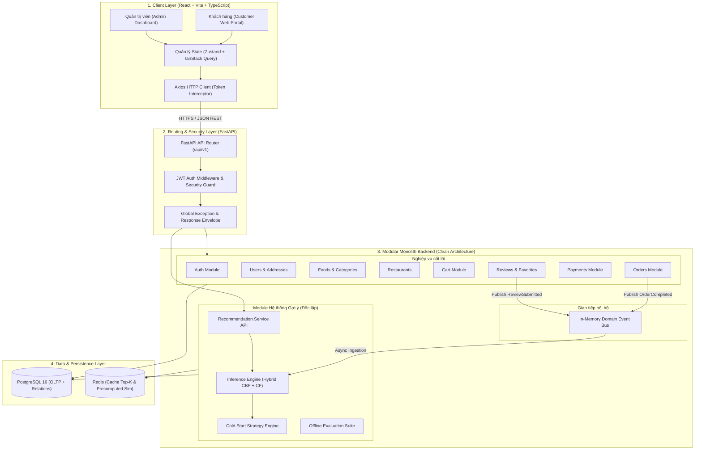
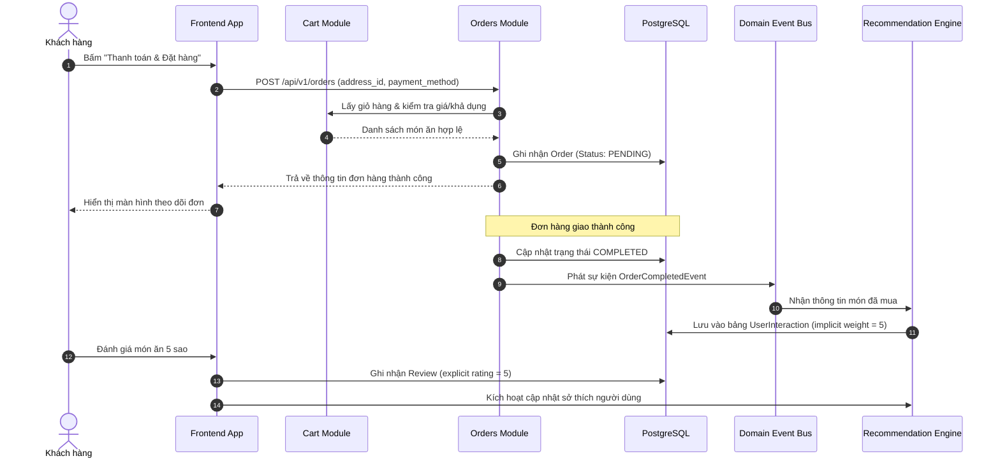
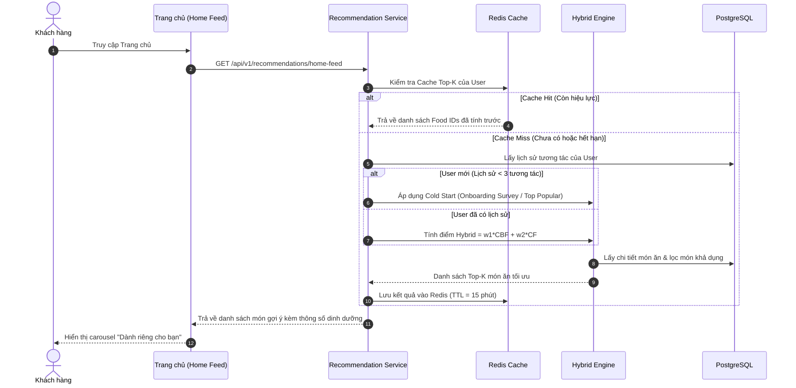

# TÀI LIỆU THIẾT KẾ KIẾN TRÚC HỆ THỐNG (PHASE 1: SYSTEM ARCHITECTURE)
## Đề tài: Xây dựng hệ thống đặt đồ ăn trực tuyến tích hợp hệ thống gợi ý món ăn
### (Online Food Ordering System Integrated with Food Recommendation System)

---

## 1. TỔNG QUAN KIẾN TRÚC HỆ THỐNG (OVERALL SYSTEM ARCHITECTURE)

Hệ thống được thiết kế theo mô hình **Modular Monolith** kết hợp nguyên lý **Clean Architecture** và **Separation of Concerns (SoC)**.

### 1.1. Lý do lựa chọn Modular Monolith
- **Giảm chi phí vận hành & độ phức tạp**: Khắc phục nhược điểm của Microservices (phân tán dữ liệu, transaction phân tán, overhead mạng, debug phức tạp) trong khi vẫn duy trì ranh giới độc lập (bounded contexts) giữa các domain.
- **Sẵn sàng chuyển đổi (Extraction-Ready)**: Mỗi module nội bộ tuân thủ giao ước hướng giao diện (Interface-Driven Development). Module nặng tính toán như `Recommendation Engine` có thể tách rời thành microservice hoặc background worker độc lập mà không cần tái cấu trúc tầng nghiệp vụ.
- **Tính toàn vẹn dữ liệu (Data Consistency)**: Cho phép sử dụng ACID Transaction của PostgreSQL cho luồng nghiệp vụ quan trọng (đặt hàng, trừ giỏ hàng, cập nhật kho), đồng thời tách biệt dữ liệu phân tích/gợi ý.

### 1.2. Các phân tầng kiến trúc tổng thể
Hệ thống gồm 4 tầng phân tách rõ rệt:
1. **Client / Presentation Layer**: Single Page Application (SPA) xây dựng bằng ReactJS, TypeScript, Tailwind CSS, shadcn/ui.
2. **API Gateway / Routing Layer**: FastAPI Router đóng vai trò Gateway phân phối request, kiểm tra xác thực (JWT Auth Guard), Rate Limiting và CORS.
3. **Application & Domain Layer (Modular Monolith)**: Các module nghiệp vụ độc lập đóng gói logic domain, xử lý nghiệp vụ thông qua Clean Architecture (Controller $\to$ Service $\to$ Repository $\to$ Model).
4. **Data & AI Layer**:
   - **PostgreSQL 16+**: Cơ sở dữ liệu quan hệ cho toàn bộ dữ liệu giao dịch OLTP và lưu trữ ma trận tương tác.
   - **Redis (Cache & Fast Lookups)**: Lưu trữ Cache Top-K gợi ý, Session/Blacklisted JWT, ma trận tương đồng món ăn (Item Similarity Matrix).
   - **Recommendation Pipeline**: Pipeline chạy độc lập (offline batch + online inference) tính toán Content-Based & Collaborative Filtering.

---

## 2. THIẾT KẾ KIẾN TRÚC FRONTEND

Frontend được xây dựng theo kiến trúc **Feature-Driven / Modular Architecture**, đảm bảo khả năng bảo trì, tái sử dụng component và kiểm thử độc lập.

```
┌─────────────────────────────────────────────────────────────┐
│                    PRESENTATION LAYER                       │
│     Pages (Router Views)  ──►  Components (shadcn/ui, UI)   │
└──────────────────────────────┬──────────────────────────────┘
                               │
┌──────────────────────────────▼──────────────────────────────┐
│                    APPLICATION STATE LAYER                  │
│   Server State: TanStack Query (Caching, Mutations, Sync)   │
│   Client State: Zustand (Cart, Auth, User Preferences, UI)  │
│   Form State:   React Hook Form + Zod Validation            │
└──────────────────────────────┬──────────────────────────────┘
                               │
┌──────────────────────────────▼──────────────────────────────┐
│                    INFRASTRUCTURE LAYER                     │
│    Axios Client (Interceptors, Token Refresh, Error Envelope)│
│    Storage Adapter (LocalStorage / Cookies)                 │
└─────────────────────────────────────────────────────────────┘
```

### 2.1. Phân bổ trách nhiệm (Separation of Concerns)
- **UI Components (Dumb Components)**: Nhận `props`, hiển thị dữ liệu và kích hoạt `callbacks`, hoàn toàn không chứa logic gọi API hoặc mutate state toàn cục.
- **Feature Containers / Pages (Smart Components)**: Lắp ghép các dumb components, liên kết với custom hooks để lấy dữ liệu.
- **Custom Hooks (`use...`)**: Đóng gói logic nghiệp vụ của Frontend (gọi TanStack Query, xử lý validation, format dữ liệu hiển thị).
- **Zustand Stores**:
  - `authStore`: Trạng thái đăng nhập, User Profile, Token.
  - `cartStore`: Giỏ hàng hiện tại, kiểm tra cùng nhà hàng, tính toán tạm tính.
  - `preferenceStore`: Bộ lọc tìm kiếm, tùy chọn dinh dưỡng, trạng thái onboarding.
- **TanStack Query (React Query)**: Quản lý toàn bộ Server State (tự động caching, revalidation, optimistic updates, garbage collection).
- **Axios HTTP Client**: Quản lý base URL, timeout, tự động đính kèm `Bearer Token` vào header, tự động gọi endpoint Refresh Token khi nhận lỗi `401 Unauthorized`.

---

## 3. THIẾT KẾ KIẾN TRÚC BACKEND

Backend tuân thủ nghiêm ngặt **Clean Architecture (Onion / Hexagonal Architecture)**:

```
┌───────────────────────────────────────────────────────────────┐
│                    API / CONTROLLER LAYER                     │
│  - FastAPI APIRouter                                          │
│  - Request DTO (Pydantic Schema Input Validation)             │
│  - Response DTO (Pydantic Schema Output Serialization)        │
│  - HTTP Status Codes, Dependency Injection (get_current_user) │
└──────────────────────────────┬────────────────────────────────┘
                               │ (calls)
┌──────────────────────────────▼────────────────────────────────┐
│                   APPLICATION SERVICE LAYER                   │
│  - Thực thi Use Cases và Business Rules                       │
│  - Phối hợp giữa các Repositories                             │
│  - Quản lý Database Transaction (@transactional)              │
│  - Phát sinh Domain Events (ví dụ: OrderCompletedEvent)       │
└──────────────────────────────┬────────────────────────────────┘
                               │ (calls via Interface)
┌──────────────────────────────▼────────────────────────────────┐
│                    DOMAIN & REPOSITORY LAYER                  │
│  - Domain Entities & Business Invariants                      │
│  - Repository Interfaces (Abstract Base Classes)              │
│  - Repository Implementations (SQLAlchemy 2.x Session/Async)  │
└──────────────────────────────┬────────────────────────────────┘
                               │ (interacts)
┌──────────────────────────────▼────────────────────────────────┐
│                 INFRASTRUCTURE & DATABASE LAYER               │
│  - PostgreSQL Database Engine                                 │
│  - Alembic Migrations                                         │
│  - Redis Cache Client                                         │
│  - External Payment Gateway Integration                       │
└───────────────────────────────────────────────────────────────┘
```

### 3.1. Các nguyên tắc Clean Architecture áp dụng:
1. **Dependency Rule**: Tầng bên trong (Domain, Service) không phụ thuộc vào tầng bên ngoài (API, Framework). Tầng Service chỉ phụ thuộc vào Repository Interface (Abstractions), không phụ thuộc trực tiếp vào SQLAlchemy Session.
2. **Pydantic Validation**: Mọi dữ liệu đầu vào được validate tự động qua Pydantic V2 Schemas trước khi chạm vào Service layer.
3. **Unit of Work & Repository Pattern**: Tách biệt logic truy vấn cơ sở dữ liệu ra khỏi logic nghiệp vụ, giúp dễ dàng viết Unit Test với Mock Repositories.

---

## 4. THIẾT KẾ KIẾN TRÚC RECOMMENDATION ENGINE

Module Recommendation Engine được thiết kế theo cấu trúc **2-Stage Pipeline (Offline Training & Precomputing + Online Real-time Serving)**:

```
┌────────────────────────────────────────────────────────────────────────┐
│              OFFLINE / BATCH RECOMMENDATION PIPELINE                   │
│                                                                        │
│  PostgreSQL (Interactions, Foods, Nutrition)                           │
│        │                                                               │
│        ▼ (ETL & Feature Extraction)                                    │
│  Feature Store / Matrix Builder                                        │
│   ├── Item Metadata Vector (TF-IDF nguyên liệu + Nutrition Vector)    │
│   └── User-Item Interaction Matrix (Rating, Order frequency, Clicks)   │
│        │                                                               │
│        ▼ (Model Training & Precomputation)                             │
│  Model Trainers:                                                       │
│   ├── ContentBasedRecommender (Cosine Similarity Precomputation)       │
│   ├── CollaborativeFilteringRecommender (SVD / Item-Item Cosine)       │
│   └── HybridEngine (Weighted Blending & Switching Strategy)           │
│        │                                                               │
│        ▼ (Serialize & Cache)                                           │
│  Storage: Redis (Precomputed Top-K & Item Sim) + Model Checkpoints    │
└──────────────────────────────────┬─────────────────────────────────────┘
                                   │
                                   ▼
┌────────────────────────────────────────────────────────────────────────┐
│                   ONLINE REAL-TIME INFERENCE SERVICE                   │
│                                                                        │
│  Incoming User Request: GET /api/v1/recommendations/home-feed          │
│        │                                                               │
│        ▼                                                               │
│  Inference Strategy:                                                   │
│   ├── Is New User (Interactions < threshold)?                          │
│   │     ├── Yes: Cold Start Strategy (Onboarding Survey / Top Popular) │
│   │     └── No:  Hybrid Scoring (w1 * CBF + w2 * CF)                  │
│   ├── Filter constraints: Status=Active, Available, Category Filter    │
│   └── Post-Processing: Diversity Re-ranking & Deduplication            │
│        │                                                               │
│        ▼                                                               │
│  Response: Return Top-K Recommended Food Items (< 100ms)               │
└────────────────────────────────────────────────────────────────────────┘
```

### 4.1. Chi tiết các thành phần:
- **Feature Processing**:
  - Dữ liệu món ăn: Chuẩn hóa vector dinh dưỡng (Min-Max Scaler cho Calories, Protein, Fat, Carbs) kết hợp ma trận đặc trưng nguyên liệu bằng TF-IDF.
  - Dữ liệu tương tác: Trọng số tương tác $w_{u,i}$ kết hợp giữa Đặt hàng (hệ số 5), Đánh giá (hệ số 4), Yêu thích (hệ số 3), Xem món (hệ số 1).
- **Cold Start Strategy Module**:
  - Nếu số lượng tương tác của người dùng $< 3$: Kích hoạt bộ suy luận Cold Start dựa trên khảo sát Onboarding (khẩu vị, danh mục yêu thích) và Top món ăn thịnh hành (Popularity).
- **Offline Evaluation Module**:
  - Module chạy kiểm nghiệm độc lập, chia dữ liệu Train/Test (80/20), tính toán các chỉ số: $Precision@K$, $Recall@K$, $NDCG@K$, $Coverage$.
  - Xuất bảng so sánh thực nghiệm minh bạch giữa các thuật toán: Popularity vs CBF vs CF vs Hybrid.

---

## 5. THIẾT KẾ LUỒNG GIAO TIẾP GIỮA CÁC MODULE (INTER-MODULE COMMUNICATION)

Trong mô hình Modular Monolith, các module giao tiếp thông qua 2 cơ chế chính:

### 5.1. Đồng bộ (Synchronous via Service Interfaces)
- Module A gọi trực tiếp Service Interface của Module B (được inject qua Dependency Injection container).
- **Ví dụ**: Khi tạo đơn hàng (`OrderService`), service này gọi `CartService.get_cart(user_id)` và `FoodService.validate_availability(food_ids)` để kiểm tra dữ liệu.
- Tuyệt đối không để Module A query trực tiếp bảng database hoặc repository nội bộ của Module B.

### 5.2. Bất đồng bộ / Hướng sự kiện trong bộ nhớ (In-Memory Domain Event Bus)
- Tránh phụ thuộc vòng (Circular Dependency) và không làm chậm các luồng xử lý giao dịch chính.
- Sử dụng cơ chế Event Emitter nội bộ (Python `asyncio` Task hoặc Event Dispatcher):
  - Khi đơn hàng hoàn thành $\to$ `OrderService` phát sự kiện `OrderCompletedEvent(user_id, order_id, food_ids)`.
  - `RecommendationModule` đăng ký lắng nghe sự kiện này $\to$ Tự động cập nhật bảng lịch sử tương tác (`UserInteraction`) mà không làm block phản hồi API của khách hàng.

---

## 6. THIẾT KẾ KIẾN TRÚC API (API ARCHITECTURE)

### 6.1. Quy ước thiết kế RESTful
- Base URL Versioning: `/api/v1/...`
- Sử dụng danh từ số nhiều cho resources: `/api/v1/foods`, `/api/v1/orders`, `/api/v1/restaurants`.
- Sử dụng chuẩn HTTP Methods:
  - `GET`: Lấy danh sách hoặc chi tiết tài nguyên (Idempotent, Safe).
  - `POST`: Tạo mới tài nguyên.
  - `PUT`: Cập nhật toàn bộ tài nguyên.
  - `PATCH`: Cập nhật một phần tài nguyên.
  - `DELETE`: Xóa tài nguyên (Soft delete khuyến nghị).

### 6.2. Cấu trúc chuẩn của Response Envelope
Mọi phản hồi từ API đều tuân thủ cấu trúc đồng nhất:

```json
{
  "success": true,
  "data": { ... },
  "message": "Thao tác thành công",
  "meta": {
    "page": 1,
    "limit": 20,
    "total_items": 150,
    "total_pages": 8
  }
}
```

Đối với lỗi (Error Envelope):
```json
{
  "success": false,
  "data": null,
  "error": {
    "code": "FOOD_OUT_OF_STOCK",
    "message": "Món ăn hiện đã hết hàng hoặc tạm ngưng phục vụ",
    "details": [
      { "field": "food_id", "issue": "Item id 45 is unavailable" }
    ]
  }
}
```

### 6.3. Quản lý phân quyền & Bảo mật API
- **Public Endpoints**: `/api/v1/auth/login`, `/api/v1/auth/register`, `/api/v1/foods`, `/api/v1/restaurants`.
- **Customer Endpoints (Yêu cầu JWT Bearer)**: `/api/v1/cart/**`, `/api/v1/orders/**`, `/api/v1/recommendations/**`, `/api/v1/users/profile`.
- **Admin Endpoints (Yêu cầu JWT + Role ADMIN)**: `/api/v1/admin/**`.

---

## 7. XÁC ĐỊNH CÁC DOMAIN VÀ TRÁCH NHIỆM TỪNG MODULE

| STT | Module Domain | Trách nhiệm chính (Single Responsibility) | Các bảng dữ liệu chính phụ trách |
| :---: | :--- | :--- | :--- |
| **1** | **Auth Module** | Đăng ký, đăng nhập, cấp phát JWT, xác thực token, mã hóa mật khẩu, refresh token. | `users`, `refresh_tokens` |
| **2** | **Users Module** | Quản lý thông tin cá nhân, cập nhật hồ sơ, quản lý sổ địa chỉ giao hàng, onboarding survey. | `user_profiles`, `user_addresses`, `user_preferences` |
| **3** | **Restaurants Module**| Quản lý thông tin nhà hàng, giờ mở cửa, địa chỉ, trạng thái hoạt động của đối tác. | `restaurants` |
| **4** | **Categories Module** | Quản lý danh mục món ăn (phân cấp cha-con nếu có), icon, thứ tự sắp xếp. | `categories` |
| **5** | **Foods Module** | Quản lý món ăn, hình ảnh, đơn giá, thành phần nguyên liệu, bảng chỉ số dinh dưỡng. | `foods`, `food_images`, `ingredients`, `food_ingredients` |
| **6** | **Cart Module** | Quản lý giỏ hàng tạm tính, ràng buộc chỉ đặt món cùng một quán, tính tổng tiền. | `carts`, `cart_items` |
| **7** | **Orders Module** | Vòng đời đơn hàng (FSM), kiểm tra tính hợp lệ, lưu trữ snapshot giá lúc đặt hàng. | `orders`, `order_items`, `order_status_logs` |
| **8** | **Payments Module** | Xử lý thanh toán COD, tích hợp Webhook cổng thanh toán Sandbox (VNPAY/MoMo). | `payments`, `payment_transactions` |
| **9** | **Reviews Module** | Đánh giá sao (1-5), nhận xét món ăn sau khi hoàn thành đơn hàng, kiểm duyệt review. | `reviews` |
| **10**| **Favorites Module** | Lưu danh sách món ăn yêu thích của khách hàng, cung cấp tín hiệu cho RecSys. | `favorites` |
| **11**| **Recommendations** | Thu thập tương tác, tính toán độ tương đồng, huấn luyện mô hình, cung cấp Top-K API. | `user_interactions`, `recommendation_logs`, `model_versions` |
| **12**| **Admin Module** | Quản trị hệ thống, điều phối và phân quyền, tổng hợp quản lý dữ liệu. | Truy cập qua các services của các module |
| **13**| **Analytics Module** | Thống kê doanh thu, báo cáo lượng đơn, dashboard chỉ số vận hành và RecSys metrics. | Views/Aggregates từ `orders`, `payments`, `recommendation_logs` |

---

## 8. THIẾT KẾ CẤU TRÚC THƯ MỤC HỆ THỐNG

### 8.1. Cấu trúc thư mục Backend (`backend/`)
Tuân thủ Modular Monolith và Clean Architecture:

```
backend/
├── app/
│   ├── main.py                     # Entry point khởi chạy FastAPI app
│   ├── config.py                   # Cấu hình Pydantic BaseSettings (.env)
│   ├── core/                       # Thành phần dùng chung toàn hệ thống
│   │   ├── database.py             # Kết nối SQLAlchemy Engine & SessionLocal
│   │   ├── security.py             # Băm mật khẩu (bcrypt), sinh JWT Token
│   │   ├── exceptions.py           # Custom Domain Exceptions & Global Handlers
│   │   ├── middlewares.py          # CORS, Request Logging, Rate Limiter
│   │   └── response.py             # Envelope formatters (success/error response)
│   │
│   ├── modules/                    # CÁC DOMAIN MODULE ĐỘC LẬP
│   │   ├── auth/
│   │   │   ├── router.py           # API endpoints (/auth/login, /auth/register)
│   │   │   ├── schemas.py          # Pydantic Schemas (LoginRequest, TokenResponse)
│   │   │   ├── services.py         # AuthService (verify_password, create_tokens)
│   │   │   └── dependencies.py     # get_current_user, require_admin
│   │   ├── users/
│   │   │   ├── router.py
│   │   │   ├── schemas.py
│   │   │   ├── services.py
│   │   │   ├── repository.py
│   │   │   └── models.py           # SQLAlchemy User, Address, Preference Models
│   │   ├── foods/
│   │   │   ├── router.py
│   │   │   ├── schemas.py
│   │   │   ├── services.py
│   │   │   ├── repository.py
│   │   │   └── models.py           # Food, Category, Ingredient, Nutrition Models
│   │   ├── restaurants/
│   │   │   ├── router.py
│   │   │   ├── schemas.py
│   │   │   ├── services.py
│   │   │   ├── repository.py
│   │   │   └── models.py
│   │   ├── cart/
│   │   │   ├── router.py
│   │   │   ├── schemas.py
│   │   │   ├── services.py
│   │   │   ├── repository.py
│   │   │   └── models.py
│   │   ├── orders/
│   │   │   ├── router.py
│   │   │   ├── schemas.py
│   │   │   ├── services.py
│   │   │   ├── repository.py
│   │   │   └── models.py
│   │   ├── payments/
│   │   ├── reviews/
│   │   ├── favorites/
│   │   └── recommendations/        # MODULE HỆ THỐNG GỢI Ý ĐỘC LẬP
│   │       ├── router.py           # API: /recommendations/home, /similar/{id}
│   │       ├── schemas.py          # Recommendation Response Schemas
│   │       ├── services.py         # RecommendationService (Inference Gateway)
│   │       ├── engine/             # Lõi thuật toán Machine Learning
│   │       │   ├── content_based.py # TF-IDF + Cosine Similarity on Nutrition/Ingredients
│   │       │   ├── collaborative.py # SVD / Item-Item Collaborative Filtering
│   │       │   ├── hybrid.py        # Weighted & Switching Hybrid Recommender
│   │       │   ├── cold_start.py    # Onboarding heuristic & Popularity ranking
│   │       │   └── evaluator.py     # Precision@K, Recall@K, NDCG@K calculation
│   │       ├── repository.py       # Truy vấn tương tác, log gợi ý
│   │       └── models.py           # UserInteraction, RecommendationLog Models
│   │
│   └── tests/                      # Kiểm thử tự động Backend
│       ├── conftest.py             # Fixtures, Test DB, Mock Data
│       ├── unit/                   # Unit tests cho từng Service
│       └── integration/            # Test tích hợp API endpoints
│
├── alembic/                        # Quản lý Database Migrations
│   ├── env.py
│   └── versions/
├── requirements.txt                # Danh sách thư viện Python
├── Dockerfile
└── alembic.ini
```

### 8.2. Cấu trúc thư mục Frontend (`frontend/`)
Tuân thủ Feature-Driven Architecture kết hợp shadcn/ui:

```
frontend/
├── src/
│   ├── main.tsx                    # React Entrypoint
│   ├── App.tsx                     # React Router & QueryClient Provider setup
│   ├── index.css                   # Tailwind CSS base & utilities
│   │
│   ├── assets/                     # Static assets (images, icons, illustrations)
│   │
│   ├── components/                 # Shared Components
│   │   ├── ui/                     # shadcn/ui primitives (Button, Dialog, Input...)
│   │   ├── layout/                 # MainLayout, Header, Footer, AdminLayout
│   │   ├── common/                 # LoadingSpinner, ErrorBoundary, EmptyState
│   │   └── feedback/               # StarRating, NutritionBadge, PriceTag
│   │
│   ├── config/                     # Biến môi trường và hằng số toàn cục
│   │   └── constants.ts
│   │
│   ├── features/                   # CÁC MODULE CHỨC NĂNG (FEATURE-DRIVEN)
│   │   ├── auth/
│   │   │   ├── components/         # LoginForm, RegisterForm
│   │   │   ├── hooks/              # useAuth, useLoginMutation
│   │   │   ├── services/           # authApi.ts
│   │   │   └── types/              # auth.types.ts
│   │   ├── foods/
│   │   │   ├── components/         # FoodCard, FoodGrid, FoodFilter, NutritionTable
│   │   │   ├── hooks/              # useFoods, useFoodDetail
│   │   │   ├── services/           # foodApi.ts
│   │   │   └── types/
│   │   ├── cart/
│   │   │   ├── components/         # CartDrawer, CartItemRow, OrderSummary
│   │   │   ├── store/              # cartStore.ts (Zustand)
│   │   │   └── types/
│   │   ├── orders/
│   │   │   ├── components/         # OrderTrackingTimeline, OrderHistoryList
│   │   │   ├── hooks/              # useCreateOrder, useOrderStatus
│   │   │   └── services/
│   │   ├── recommendations/        # Thành phần giao diện gợi ý cá nhân hóa
│   │   │   ├── components/         # PersonalizedCarousel, SimilarFoodsSection
│   │   │   ├── hooks/              # useRecommendations, useColdStartSurvey
│   │   │   └── services/           # recommendationApi.ts
│   │   └── admin/                  # Dashboard, Table Management Pages
│   │
│   ├── hooks/                      # Global Hooks (useDebounce, useLocalStorage...)
│   ├── lib/                        # Axios instance, Utils (cn, formatCurrency)
│   │   ├── api-client.ts           # Axios client kèm Token Interceptor
│   │   └── utils.ts
│   ├── routes/                     # Router Configuration (Public, Protected, Admin)
│   │   └── index.tsx
│   └── types/                      # Global TypeScript Definitions
│       └── api.types.ts            # ApiResponse, PaginatedResponse
│
├── package.json
├── tsconfig.json
├── vite.config.ts
├── tailwind.config.js
└── components.json                 # Cấu hình shadcn/ui
```

---

## 9. SƠ ĐỒ SYSTEM ARCHITECTURE BẰNG MERMAID

Sơ đồ thể hiện toàn bộ các tầng và mối quan hệ giữa Frontend, Backend Modular Monolith, Cơ sở dữ liệu và AI Engine:



---

## 10. SƠ ĐỒ DATA FLOW (LUỒNG DỮ LIỆU)

### 10.1. Luồng dữ liệu Đặt hàng & Phản hồi (Order & Feedback Loop)



### 10.2. Luồng dữ liệu Gợi ý món ăn (Recommendation Data Flow)



---

## 11. BẢNG KIỂM TRA TÍNH NHẤT QUÁN CỦA KIẾN TRÚC (CONSISTENCY CHECK)

Trước khi nghiệm thu Phase 1, kiến trúc đã được đối soát với các nguyên tắc đề ra:

| Tiêu chuẩn thiết kế | Đánh giá kiểm tra | Trạng thái |
| :--- | :--- | :---: |
| **Separation of Concerns** | Tách biệt triệt để Presentation, Domain/Service, Repository và RecSys Engine. Không có logic DB trong router. | **ĐẠT** |
| **Clean Architecture** | Dependency rule tuân thủ nghiêm ngặt: Core Domain không phụ thuộc tầng ngoài. | **ĐẠT** |
| **Modular Monolith** | 13 module có ranh giới rõ ràng, không truy vấn chéo bảng dữ liệu của nhau, giao tiếp qua Service Interface hoặc Event Bus. | **ĐẠT** |
| **RecSys Isolation** | Thuật toán Machine Learning được bao gói trong submodule `recommendations/engine/`, sẵn sàng trích xuất thành worker độc lập. | **ĐẠT** |
| **Non-Functional Requirements** | Kiến trúc hỗ trợ Redis Caching đáp ứng mục tiêu độ trễ $\le 150\text{ ms}$ cho API và $\le 200\text{ ms}$ cho RecSys. | **ĐẠT** |

---
**Trạng thái**: Hoàn thành Phase 1. Đang chờ xác nhận từ Quản trị / Giảng viên hướng dẫn để chuyển sang **Phase 2: UI/UX Design** hoặc chuẩn bị cho các bước tiếp theo.

