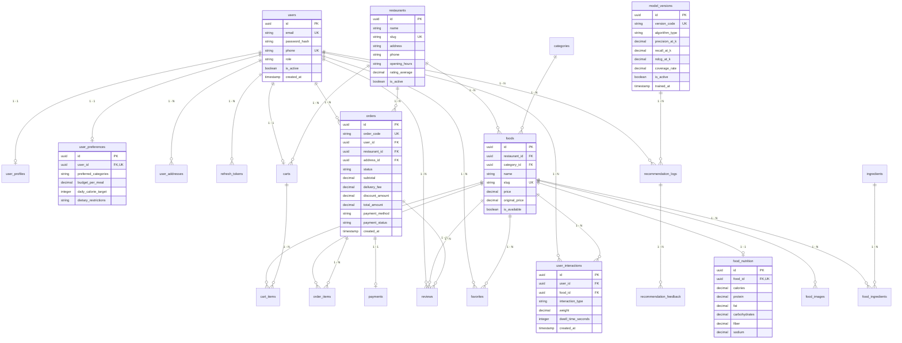

# TÀI LIỆU THIẾT KẾ CƠ SỞ DỮ LIỆU (PHASE 3: DATABASE DESIGN)
## Đề tài: Xây dựng hệ thống đặt đồ ăn trực tuyến tích hợp hệ thống gợi ý món ăn
### (Online Food Ordering System Integrated with Food Recommendation System)

---

## 1. PHÂN TÍCH CÁC THỰC THỂ DỮ LIỆU (ENTITY ANALYSIS)

Cơ sở dữ liệu được thiết kế trên hệ quản trị **PostgreSQL 16+**, tuân thủ chuẩn hóa **3NF (Third Normal Form)**, đảm bảo toàn vẹn dữ liệu giao dịch (ACID) cho hoạt động đặt món và tối ưu hóa cấu trúc cho bài toán Hệ thống Gợi ý (RecSys).

Hệ thống bao gồm 20 bảng dữ liệu chính, phân thành 5 phân nhóm nghiệp vụ:

### 1.1. Nhóm Người dùng & Phân quyền (Users & Authentication)
- `users`: Tài khoản người dùng (Khách hàng, Quản trị viên, Nhân viên), quản lý xác thực mật khẩu băm, email, số điện thoại, vai trò và trạng thái.
- `refresh_tokens`: Lưu trữ JWT Refresh Tokens phục vụ cơ chế cấp mới phiên làm việc và thu hồi token (Token Blacklisting).
- `user_profiles`: Thông tin hồ sơ chi tiết (Họ tên, ảnh đại diện, giới tính, ngày sinh).
- `user_addresses`: Sổ địa chỉ giao hàng của người dùng, lưu tọa độ địa lý (Latitude, Longitude), đánh dấu địa chỉ mặc định.
- `user_preferences`: **Thực thể phục vụ RecSys (Cold Start & Personalization)**: Lưu sở thích danh mục ẩm thực, ngân sách bữa ăn trung bình, mục tiêu calo hàng ngày, hạn chế ăn kiêng (Dị ứng, Ăn chay).

### 1.2. Nhóm Đối tác & Thực đơn (Restaurants & Foods Catalog)
- `restaurants`: Thông tin nhà hàng/quán ăn đối tác (Tên, địa chỉ, giờ đóng/mở cửa, xếp hạng trung bình, trạng thái hoạt động).
- `categories`: Danh mục món ăn phân loại theo dạng ẩm thực (Cơm, Bún/Phở, Đồ uống, Healthy, Đồ ăn vặt...).
- `foods`: Thực đơn món ăn chi tiết (Tên món, mô tả, đơn giá, giá gốc, trạng thái còn/hết hàng, liên kết nhà hàng và danh mục).
- `food_images`: Bộ sưu tập hình ảnh của món ăn (URL, ảnh đại diện chính, thứ tự sắp xếp).
- `ingredients`: Từ điển thành phần nguyên liệu món ăn (Thịt gà, Bò, Cà chua, Sốt mè rang...).
- `food_ingredients`: Bảng trung gian thể hiện mối quan hệ N-N giữa món ăn và nguyên liệu, kèm hàm lượng hoặc định lượng.
- `food_nutrition`: **Thực thể cốt lõi cho Content-Based RecSys**: Lưu trữ chính xác bảng giá trị dinh dưỡng của từng món ăn (Calories, Protein, Fat, Carbohydrates, Fiber, Sodium).

### 1.3. Nhóm Giao dịch & Đơn hàng (Carts, Orders & Payments)
- `carts`: Giỏ hàng của người dùng. Ràng buộc nghiệp vụ: một giỏ hàng tại một thời điểm chỉ chứa món của một nhà hàng (`restaurant_id`).
- `cart_items`: Chi tiết từng món ăn trong giỏ hàng, số lượng, đơn giá tạm tính và ghi chú món ăn.
- `orders`: Đơn đặt hàng hoàn chỉnh, quản lý máy trạng thái đơn hàng (FSM: `PENDING` $\to$ `CONFIRMED` $\to$ `PREPARING` $\to$ `DELIVERING` $\to$ `COMPLETED` / `CANCELLED`), snapshot địa chỉ giao hàng và tổng tiền.
- `order_items`: Snapshot danh sách món ăn tại thời điểm chốt đơn (Tên món lúc mua, đơn giá lúc mua, số lượng, thành tiền).
- `payments`: Quản lý giao dịch thanh toán (COD, Cổng thanh toán Sandbox VNPAY/MoMo), mã giao dịch và trạng thái thanh toán.

### 1.4. Nhóm Phản hồi & Tương tác (Reviews & User Interactions)
- `reviews`: Đánh giá sao (1-5) và nhận xét của khách hàng sau khi đơn hàng hoàn thành (Explicit Feedback).
- `favorites`: Danh sách món ăn được khách hàng lưu yêu thích (Explicit Bookmark).
- `user_interactions`: **Bảng vàng của RecSys**: Thu thập toàn bộ tương tác ngầm định và tường minh (View, Click, Add to Cart, Order, Review) kèm trọng số $w_{u,i}$ và thời lượng xem (dwell time).

### 1.5. Nhóm Quản trị AI (Recommendation System Management)
- `model_versions`: Quản lý phiên bản các mô hình AI đã huấn luyện (CBF, CF SVD, Hybrid), siêu tham số và các chỉ số đo lường thực nghiệm ($Precision@K$, $Recall@K$, $NDCG@K$, $Coverage$).
- `recommendation_logs`: Ghi nhận lịch sử mỗi lần hệ thống phục vụ gợi ý cho người dùng (Top-K món được đề xuất tại vị trí nào, mô hình nào tạo ra).
- `recommendation_feedback`: Ghi nhận phản hồi trực tiếp của người dùng đối với các mục gợi ý (Click vào xem, Mua ngay, Bỏ qua, Bấm Không quan tâm) để phục vụ Online Evaluation và Reinforcement Learning.

---

## 2. SƠ ĐỒ THỰC THỂ QUAN HỆ (ERD - ENTITY RELATIONSHIP DIAGRAM)

---

## 3. BẢNG QUAN HỆ & RÀNG BUỘC TOÀN VẸN (RELATIONSHIPS & CONSTRAINTS)

### 3.1. Các mối quan hệ 1 - 1 (One-to-One)
- `users` $\leftrightarrow$ `user_profiles`: Mỗi tài khoản người dùng có duy nhất một hồ sơ cá nhân.
- `users` $\leftrightarrow$ `user_preferences`: Mỗi người dùng có một bản ghi cấu hình sở thích ẩm thực và mục tiêu dinh dưỡng (`user_id` là Foreign Key kèm Unique Constraint).
- `users` $\leftrightarrow$ `carts`: Mỗi người dùng sở hữu duy nhất một giỏ hàng đang hoạt động (`user_id` Unique Constraint trong `carts`).
- `foods` $\leftrightarrow$ `food_nutrition`: Mỗi món ăn có duy nhất một bộ thông số dinh dưỡng định lượng (`food_id` Unique Constraint trong `food_nutrition`).
- `orders` $\leftrightarrow$ `payments`: Mỗi đơn hàng liên kết với một bản ghi thanh toán chính thức (`order_id` Unique Constraint trong `payments`).

### 3.2. Các mối quan hệ 1 - N (One-to-Many)
- `users` $\to$ `user_addresses`: Một người dùng có thể lưu nhiều địa chỉ (Nhà riêng, Văn phòng...).
- `restaurants` $\to$ `foods`: Một nhà hàng cung cấp nhiều món ăn.
- `categories` $\to$ `foods`: Một danh mục ẩm thực chứa nhiều món ăn.
- `foods` $\to$ `food_images`: Một món ăn có thể có nhiều hình ảnh góc chụp khác nhau.
- `carts` $\to$ `cart_items`: Một giỏ hàng chứa nhiều dòng món ăn được chọn.
- `orders` $\to$ `order_items`: Một đơn hàng gồm nhiều chi tiết món ăn (snapshot lúc đặt).
- `users` $\to$ `orders`: Một khách hàng có thể thực hiện nhiều đơn hàng theo thời gian.
- `model_versions` $\to$ `recommendation_logs`: Một phiên bản mô hình AI phục vụ nhiều lượt gợi ý được ghi log.
- `recommendation_logs` $\to$ `recommendation_feedback`: Một lượt gợi ý (Top-K) có thể nhận phản hồi click/mua trên từng món.

### 3.3. Các mối quan hệ N - N (Many-to-Many)
- `foods` $\leftrightarrow$ `ingredients`: Một món ăn được tạo thành từ nhiều nguyên liệu, và một nguyên liệu có thể xuất hiện trong nhiều món ăn. Giải quyết thông qua bảng nối `food_ingredients` (chứa thêm trường định lượng).
- `users` $\leftrightarrow$ `foods` (Favorites): Quan hệ yêu thích món ăn thông qua bảng nối `favorites` (khóa tổ hợp `(user_id, food_id)` Unique).
- `users` $\leftrightarrow$ `foods` (Interactions): Quan hệ tương tác hành vi thông qua bảng nối lịch sử `user_interactions`.

---

## 4. CHI TIẾT ĐẶC TẢ CÁC BẢNG DỮ LIỆU & INDEXING

### 4.1. Bảng `users` (Tài khoản người dùng)
- **Mục đích**: Lưu thông tin đăng nhập và phân quyền hệ thống.

| Tên trường | Kiểu dữ liệu | Ràng buộc | Mô tả |
| :--- | :--- | :--- | :--- |
| `id` | UUID | PK, Default gen_random_uuid() | Khóa chính duy nhất |
| `email` | VARCHAR(255) | UNIQUE, NOT NULL | Địa chỉ email đăng nhập |
| `password_hash` | VARCHAR(255) | NOT NULL | Mật khẩu băm (bcrypt) |
| `phone` | VARCHAR(20) | UNIQUE, NULLABLE | Số điện thoại liên lạc |
| `role` | VARCHAR(30) | NOT NULL, Default 'CUSTOMER' | Phân quyền: `CUSTOMER`, `ADMIN`, `STAFF` |
| `is_active` | BOOLEAN | NOT NULL, Default TRUE | Trạng thái tài khoản |
| `created_at` | TIMESTAMP WITH TIME ZONE | NOT NULL, Default NOW() | Thời gian tạo |
| `updated_at` | TIMESTAMP WITH TIME ZONE | NOT NULL, Default NOW() | Thời gian cập nhật |

- **Indexes**:
  - `idx_users_email` (B-Tree trên `email` - Tối ưu tra cứu đăng nhập $O(1)$).
  - `idx_users_phone` (B-Tree trên `phone`).

---

### 4.2. Bảng `user_preferences` (Sở thích & Mục tiêu Dinh dưỡng RecSys)
- **Mục đích**: **Phục vụ giải quyết Cold Start và lọc theo dinh dưỡng**.

| Tên trường | Kiểu dữ liệu | Ràng buộc | Mô tả |
| :--- | :--- | :--- | :--- |
| `id` | UUID | PK | Khóa chính |
| `user_id` | UUID | FK $\to$ users.id, UNIQUE, CASCADE | Khóa ngoại tới user (1-1) |
| `preferred_categories` | JSONB | NULLABLE | Mảng ID các danh mục yêu thích: `["uuid-1", "uuid-2"]` |
| `budget_per_meal` | NUMERIC(12, 2) | NULLABLE | Ngân sách trung bình/bữa ăn |
| `daily_calorie_target` | INTEGER | NULLABLE | Mục tiêu calories hàng ngày (ví dụ: 2000 kcal) |
| `preferred_protein_min` | NUMERIC(6, 2) | NULLABLE | Protein tối thiểu mong muốn mỗi bữa (gam) |
| `dietary_restrictions` | JSONB | NULLABLE | Danh sách kiêng kỵ: `["NO_SPICY", "VEGETARIAN", "LOW_CARB"]` |
| `is_onboarded` | BOOLEAN | NOT NULL, Default FALSE | Đã hoàn thành khảo sát Cold Start chưa |
| `updated_at` | TIMESTAMP WITH TIME ZONE | NOT NULL, Default NOW() | Thời gian cập nhật |

---

### 4.3. Bảng `foods` (Thực đơn món ăn)
- **Mục đích**: Danh mục món ăn kinh doanh của các nhà hàng.

| Tên trường | Kiểu dữ liệu | Ràng buộc | Mô tả |
| :--- | :--- | :--- | :--- |
| `id` | UUID | PK | Khóa chính |
| `restaurant_id` | UUID | FK $\to$ restaurants.id, NOT NULL | Nhà hàng cung cấp |
| `category_id` | UUID | FK $\to$ categories.id, NOT NULL | Danh mục món |
| `name` | VARCHAR(255) | NOT NULL | Tên món ăn |
| `slug` | VARCHAR(255) | UNIQUE, NOT NULL | Đường dẫn thân thiện SEO |
| `description` | TEXT | NULLABLE | Mô tả chi tiết món ăn |
| `price` | NUMERIC(12, 2) | NOT NULL | Giá bán hiện tại (VND) |
| `original_price` | NUMERIC(12, 2) | NULLABLE | Giá gốc niêm yết (nếu có giảm giá) |
| `is_available` | BOOLEAN | NOT NULL, Default TRUE | Món đang phục vụ / Tạm hết |
| `view_count` | INTEGER | NOT NULL, Default 0 | Số lượt click xem chi tiết |
| `order_count` | INTEGER | NOT NULL, Default 0 | Số lượt đặt thành công |
| `rating_average` | NUMERIC(3, 2) | NOT NULL, Default 0.00 | Đánh giá sao trung bình (1.00 - 5.00) |
| `created_at` | TIMESTAMP WITH TIME ZONE | NOT NULL, Default NOW() | Thời điểm tạo |

- **Indexes**:
  - `idx_foods_restaurant_id` (Lọc món ăn theo nhà hàng).
  - `idx_foods_category_id` (Lọc món ăn theo danh mục).
  - `idx_foods_price` (Lọc và sắp xếp theo khoảng giá).
  - `idx_foods_rating_order` (Compound index `(rating_average DESC, order_count DESC)` phục vụ thuật toán Top Popular).

---

### 4.4. Bảng `food_nutrition` (Chỉ số dinh dưỡng món ăn)
- **Mục đích**: **Cung cấp không gian đặc trưng dinh dưỡng (Nutrition Feature Vector) cho Content-Based Filtering**.

| Tên trường | Kiểu dữ liệu | Ràng buộc | Mô tả |
| :--- | :--- | :--- | :--- |
| `id` | UUID | PK | Khóa chính |
| `food_id` | UUID | FK $\to$ foods.id, UNIQUE, CASCADE | Khóa ngoại 1-1 tới món ăn |
| `calories` | NUMERIC(8, 2) | NOT NULL | Năng lượng (kcal) |
| `protein` | NUMERIC(8, 2) | NOT NULL | Hàm lượng đạm (g) |
| `fat` | NUMERIC(8, 2) | NOT NULL | Hàm lượng chất béo (g) |
| `carbohydrates` | NUMERIC(8, 2) | NOT NULL | Hàm lượng tinh bột/đường (g) |
| `fiber` | NUMERIC(8, 2) | NULLABLE, Default 0 | Hàm lượng chất xơ (g) |
| `sodium` | NUMERIC(8, 2) | NULLABLE, Default 0 | Hàm lượng Natri/muối (mg) |

- **Indexes**:
  - `idx_nutrition_calories` (B-Tree trên `calories` - Phục vụ lọc nhanh món theo calo).
  - `idx_nutrition_protein` (B-Tree trên `protein` - Phục vụ gợi ý món tăng cơ).
  - `idx_nutrition_macro` (Compound index trên `(calories, protein, fat, carbohydrates)` để trích xuất feature vector nhanh theo batch).

---

### 4.5. Bảng `orders` & `order_items` (Đơn hàng & Chi tiết)
- **Mục đích**: Quản lý giao dịch mua hàng, là cơ sở tạo tương tác implicit có trọng số cao nhất cho RecSys.

**Bảng `orders`**:
- `id` (UUID, PK), `order_code` (VARCHAR(30), UNIQUE - Mã hiển thị như `#ORD-2026-0001`).
- `user_id` (UUID, FK $\to$ users), `restaurant_id` (UUID, FK $\to$ restaurants), `address_id` (UUID, FK $\to$ user_addresses).
- `status` (VARCHAR(30), NOT NULL - `PENDING`, `CONFIRMED`, `PREPARING`, `DELIVERING`, `COMPLETED`, `CANCELLED`).
- `subtotal` (NUMERIC(12,2)), `delivery_fee` (NUMERIC(12,2)), `discount_amount` (NUMERIC(12,2)), `total_amount` (NUMERIC(12,2)).
- `payment_method` (VARCHAR(30) - `COD`, `VNPAY`, `MOMO`), `payment_status` (VARCHAR(30) - `UNPAID`, `PAID`, `REFUNDED`).
- `cancellation_reason` (TEXT, NULLABLE).
- `created_at`, `updated_at`.
- **Indexes**: `idx_orders_user_created` (`user_id, created_at DESC`), `idx_orders_status` (`status`).

**Bảng `order_items`**:
- `id` (UUID, PK), `order_id` (UUID, FK $\to$ orders, CASCADE), `food_id` (UUID, FK $\to$ foods).
- `food_name_snapshot` (VARCHAR(255) - Giữ tên món tại thời điểm đặt).
- `unit_price_snapshot` (NUMERIC(12,2) - Giữ giá món tại thời điểm đặt).
- `quantity` (INTEGER, CHECK > 0), `subtotal` (NUMERIC(12,2)).
- **Indexes**: `idx_order_items_order_id`, `idx_order_items_food_id` (Dùng để tính toán ma trận đồng xuất hiện Item Co-occurrence).

---

### 4.6. Bảng `reviews` (Đánh giá tường minh - Explicit Feedback)
- **Mục đích**: Thu thập đánh giá sao của khách hàng cho từng món ăn sau khi dùng bữa.

| Tên trường | Kiểu dữ liệu | Ràng buộc | Mô tả |
| :--- | :--- | :--- | :--- |
| `id` | UUID | PK | Khóa chính |
| `user_id` | UUID | FK $\to$ users.id, NOT NULL | Khách hàng đánh giá |
| `food_id` | UUID | FK $\to$ foods.id, NOT NULL | Món ăn được đánh giá |
| `order_id` | UUID | FK $\to$ orders.id, NOT NULL | Đơn hàng gốc đã mua |
| `rating` | SMALLINT | NOT NULL, CHECK (1 $\le$ rating $\le$ 5) | Số sao đánh giá từ 1 đến 5 |
| `comment` | TEXT | NULLABLE | Nội dung nhận xét |
| `is_visible` | BOOLEAN | NOT NULL, Default TRUE | Trạng thái hiển thị (kiểm duyệt) |
| `created_at` | TIMESTAMP WITH TIME ZONE | NOT NULL, Default NOW() | Thời gian đánh giá |

- **Constraints**: `UNIQUE (user_id, food_id, order_id)` (Mỗi đơn hàng khách chỉ được đánh giá 1 lần cho mỗi món).
- **Indexes**: `idx_reviews_food_id` (Tính sao trung bình món), `idx_reviews_user_food` (`user_id, food_id`).

---

### 4.7. Bảng `user_interactions` (Tương tác Người dùng - Item Interaction Data)
- **Mục đích**: **Kho dữ liệu tương tác phục vụ Collaborative Filtering & Hybrid Engine**.

| Tên trường | Kiểu dữ liệu | Ràng buộc | Mô tả |
| :--- | :--- | :--- | :--- |
| `id` | UUID | PK | Khóa chính |
| `user_id` | UUID | FK $\to$ users.id, NOT NULL | Người dùng tương tác |
| `food_id` | UUID | FK $\to$ foods.id, NOT NULL | Món ăn tương tác |
| `interaction_type` | VARCHAR(30) | NOT NULL | Loại tương tác: `VIEW`, `CLICK`, `ADD_TO_CART`, `ORDER`, `FAVORITE`, `REVIEW` |
| `interaction_weight`| NUMERIC(4, 2) | NOT NULL | Trọng số tương tác quy đổi (ví dụ: VIEW=1.0, CART=3.0, ORDER=5.0) |
| `dwell_time_seconds`| INTEGER | NULLABLE | Thời gian dừng xem món (giây) |
| `created_at` | TIMESTAMP WITH TIME ZONE | NOT NULL, Default NOW() | Thời điểm phát sinh sự kiện |

- **Indexes**:
  - `idx_interactions_user_food` (`user_id, food_id` - Tối ưu truy vấn ma trận người dùng - món ăn).
  - `idx_interactions_created_at` (Phục vụ việc chia tập Train/Test theo chuỗi thời gian - Time-based splitting).

---

### 4.8. Bảng `recommendation_logs` & `recommendation_feedback` (Giám sát AI)
- **Mục đích**: Ghi nhận toàn bộ kết quả suy luận gợi ý để đo lường CTR, Conversion Rate và lưu vết thử nghiệm khoa học.

**Bảng `recommendation_logs`**:
- `id` (UUID, PK).
- `user_id` (UUID, FK $\to$ users, NULLABLE - hỗ trợ cả khách chưa đăng nhập).
- `model_version` (VARCHAR(50), NOT NULL - ví dụ: `v1.2-hybrid-svd-cbf`).
- `recommendation_type` (VARCHAR(50) - `HOME_FEED`, `SIMILAR_FOOD`, `CART_UPSELL`).
- `recommended_item_ids` (JSONB - Mảng UUID món ăn được gợi ý kèm thứ hạng: `[{"food_id": "...", "score": 0.94, "rank": 1}]`).
- `created_at` (TIMESTAMP WITH TIME ZONE, Default NOW()).

**Bảng `recommendation_feedback`**:
- `id` (UUID, PK), `log_id` (UUID, FK $\to$ recommendation_logs, CASCADE), `user_id` (UUID, FK $\to$ users).
- `food_id` (UUID, FK $\to$ foods).
- `feedback_type` (VARCHAR(30) - `IMPRESSION`, `CLICK`, `PURCHASE`, `DISLIKE`).
- `created_at`.

---

### 4.9. Bảng `model_versions` (Quản lý Phiên bản Mô hình AI)
- **Mục đích**: **Lưu trữ kết quả thực nghiệm khoa học, đảm bảo tính tái lập (Reproducibility)**.

| Tên trường | Kiểu dữ liệu | Ràng buộc | Mô tả |
| :--- | :--- | :--- | :--- |
| `id` | UUID | PK | Khóa chính |
| `version_code` | VARCHAR(50) | UNIQUE, NOT NULL | Mã phiên bản (ví dụ: `v1.0-cbf-tfidf`, `v1.1-svd-k20`) |
| `algorithm_type` | VARCHAR(50) | NOT NULL | `CONTENT_BASED`, `COLLABORATIVE_SVD`, `HYBRID_WEIGHTED` |
| `hyperparameters` | JSONB | NOT NULL | Cấu hình siêu tham số (n_factors, lr, reg, weights...) |
| `precision_at_k` | NUMERIC(6, 4) | NOT NULL | Chỉ số $Precision@10$ đo trên tập Test |
| `recall_at_k` | NUMERIC(6, 4) | NOT NULL | Chỉ số $Recall@10$ đo trên tập Test |
| `ndcg_at_k` | NUMERIC(6, 4) | NOT NULL | Chỉ số $NDCG@10$ đo trên tập Test |
| `coverage_rate` | NUMERIC(6, 4) | NOT NULL | Độ bao phủ danh mục món ($Coverage$) |
| `is_active` | BOOLEAN | NOT NULL, Default FALSE | Mô hình hiện đang phục vụ Production |
| `trained_at` | TIMESTAMP WITH TIME ZONE | NOT NULL, Default NOW() | Thời điểm hoàn thành huấn luyện |

---

## 5. KẾT LUẬN THIẾT KẾ & TÍNH TOÀN VẸN DỮ LIỆU

1. **Chuẩn hóa 3NF**: Mọi quan hệ phụ thuộc bắc cầu được loại bỏ, dữ liệu món ăn, dinh dưỡng, nguyên liệu và nhà hàng được lưu trữ không dư thừa.
2. **Snapshot lịch sử**: Bảng `order_items` lưu trữ bản chụp (snapshot) của tên món và đơn giá lúc mua, bảo đảm doanh thu trong quá khứ không bị thay đổi khi nhà hàng sửa giá món trong tương lai.
3. **Tối ưu hóa RecSys**: Bảng `user_interactions`, `food_nutrition` và `user_preferences` cung cấp trọn vẹn đặc trưng cho cả 3 nhánh thuật toán (CBF, CF và Cold Start).

---
**Trạng thái**: Đã phân tích toàn diện. Sẵn sàng hiện thực hóa bằng mã nguồn **SQLAlchemy 2.x Models** và kiểm tra **Alembic Migration**.

