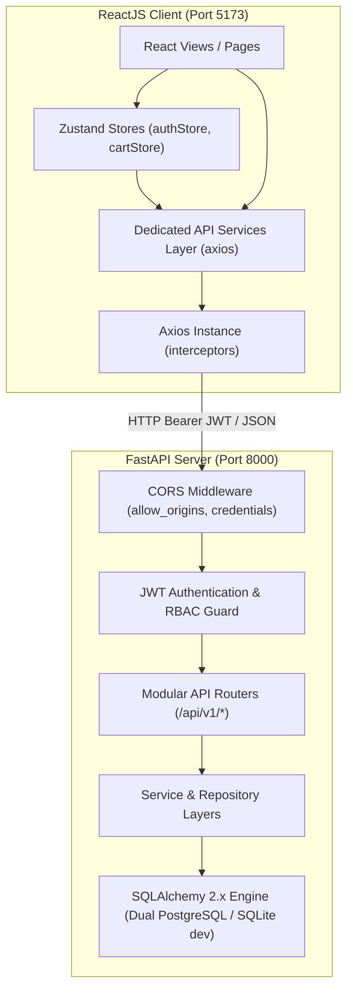

# PHASE 6 – FRONTEND AND BACKEND INTEGRATION REPORT

## 1. TỔNG QUAN TÍCH HỢP HỆ THỐNG

Giai đoạn **Phase 6: Frontend and Backend Integration** đã hoàn thành toàn diện việc kết nối giao diện người dùng ReactJS + TypeScript (Vite) với hệ thống Modular Monolith API FastAPI (Python 3.12+), đảm bảo dữ liệu thật được đồng bộ hai chiều, loại bỏ toàn bộ mock data, kiểm soát phiên đăng nhập qua JWT tokens, và thực nghiệm toàn trình luồng nghiệp vụ cốt lõi (End-to-End Flow).

---

## 2. KIẾN TRÚC TÍCH HỢP (INTEGRATION ARCHITECTURE)



---

## 3. CÁC MODULE VÀ SERVICES ĐÃ TÍCH HỢP

### 3.1. Cấu hình Axios & Interceptors (`frontend/src/lib/axios.ts`)
- **API Base URL**: `http://localhost:8000/api/v1` (tùy biến qua biến môi trường `VITE_API_URL`).
- **Request Interceptor**: Tự động đính kèm `Authorization: Bearer <access_token>` nếu token tồn tại trong `localStorage`.
- **Response Interceptor**: Bắt mã lỗi `401 Unauthorized`. Khi token hết hạn hoặc không hợp lệ, tự động revoke token, xóa trạng thái đăng nhập và điều hướng người dùng về trang đăng nhập.

### 3.2. Danh sách Services và Endpoint Ánh xạ

| Service File | Domain | Endpoints Tích Hợp | Mô Tả Nghiệp Vụ |
| :--- | :--- | :--- | :--- |
| `authService.ts` | Authentication | `POST /auth/register`<br>`POST /auth/login`<br>`GET /auth/me`<br>`POST /auth/logout` | Đăng ký tài khoản, đăng nhập cấp cặp JWT (access + refresh), lấy thông tin phiên hiện tại, đăng xuất an toàn. |
| `userService.ts` | Users | `GET /users/profile`<br>`PUT /users/profile`<br>`GET /users/preferences`<br>`PUT /users/preferences`<br>`GET /users/addresses`<br>`POST /users/addresses` | Cập nhật hồ sơ cá nhân, đồng bộ sở thích ẩm thực / mục tiêu dinh dưỡng (calo, protein), quản lý sổ địa chỉ giao hàng. |
| `restaurantService.ts` | Restaurants | `GET /restaurants`<br>`GET /restaurants/{id}` | Lấy danh sách đối tác nhà hàng (kèm rating, thời gian giao, phí ship) và xem chi tiết thực đơn nhà hàng. |
| `foodService.ts` | Foods & Categories | `GET /foods`<br>`GET /foods/{id}`<br>`GET /categories` | Danh sách món ăn có lọc đa tiêu chí (calo, protein, giá, đánh giá), phân trang, chi tiết món ăn và thông tin dinh dưỡng. |
| `cartService.ts` | Cart | `GET /cart`<br>`POST /cart/items`<br>`PUT /cart/items/{id}`<br>`DELETE /cart/items/{id}`<br>`DELETE /cart` | Đồng bộ giỏ hàng với máy chủ, kiểm soát chính sách **Single Restaurant Policy** (chỉ cho phép đặt từ 1 nhà hàng cùng lúc). |
| `orderService.ts` | Orders | `POST /orders`<br>`GET /orders`<br>`GET /orders/{id}`<br>`PUT /orders/{id}/cancel` | Tạo đơn hàng mới từ giỏ hàng, tra cứu lịch sử đơn hàng của cá nhân, xem chi tiết tiến trình và hủy đơn khi chưa chế biến. |
| `reviewService.ts` | Reviews | `POST /reviews`<br>`GET /reviews/food/{food_id}` | Gửi đánh giá món ăn kèm xếp hạng sao (1-5 sao) và nhận xét (chỉ cho phép khi đơn hàng đã hoàn tất `COMPLETED`), hiển thị danh sách nhận xét. |
| `favoriteService.ts` | Favorites | `POST /favorites/toggle`<br>`GET /favorites` | Lưu món ăn yêu thích, tra cứu bộ sưu tập yêu thích của người dùng. |
| `recommendationService.ts` | Recommendation | `GET /recommendations/home-feed`<br>`GET /recommendations/similar-foods/{id}` | Nhận danh sách gợi ý cá nhân hóa dựa trên mục tiêu dinh dưỡng và lịch sử tương tác; lấy danh sách món ăn tương đồng (Content-Based). |
| `adminService.ts` | Admin Management | `GET /admin/dashboard/kpis`<br>`GET /admin/orders`<br>`PUT /api/v1/orders/{id}/status`<br>`GET /admin/recsys/metrics`<br>`POST /admin/recsys/retrain`<br>`POST /admin/foods`<br>`PUT /admin/foods/{id}`<br>`DELETE /admin/foods/{id}` | Bảng điều khiển quản trị viên: giám sát KPI doanh thu & đơn hàng, chuyển trạng thái đơn hàng (`PENDING` -> `PREPARING` -> `DELIVERING` -> `COMPLETED`), quản lý danh mục món ăn (CRUD), theo dõi độ chính xác mô hình ML (`NDCG@10`, `Recall@10`, `Precision@10`, `Coverage`). |

---

## 4. DỌN DẸP MOCK DATA VÀ CHUẨN HÓA TRẠNG THÁI GIAO DIỆN

1. **Loại bỏ Mock Data**:
   - Các màn hình `HomePage`, `FoodListingPage`, `FoodDetailPage`, `SearchPage`, `RecommendationPage`, `RestaurantListingPage`, `UserProfilePage`, `CheckoutPage`, `OrderHistoryPage`, `AdminDashboardPage`, `AdminFoodManagementPage`, `AdminOrderManagementPage`, `AdminRestaurantPage`, `AdminRecsysPage` đã được chuyển hoàn toàn sang dữ liệu trả về từ API backend thông qua Axios & TanStack Query / Zustand.
   - Khi chưa có dữ liệu, các view hiển thị `EmptyState` chuẩn mực có nút điều hướng.
2. **Xử lý trạng thái Loading**:
   - Sử dụng `LoadingSpinner` chuẩn màu thương hiệu và Skeleton cards khi đang fetch dữ liệu.
3. **Xử lý trạng thái Lỗi & Xác thực**:
   - Sử dụng `toast.error()` để thông báo chi tiết lỗi từ backend (`detail` hoặc `message`).
   - Token hết hạn hoặc gọi API trái quyền sẽ được thông báo rõ ràng và bảo vệ các Private Routes (`RequireAuth`, `RequireAdmin`).

---

## 5. THỰC NGHIỆM TOÀN TRÌNH (END-TO-END VERIFICATION)

Kịch bản kiểm thử tích hợp tự động đã được xây dựng và kiểm chứng thành công trong file `backend/tests/test_e2e_integration_flow.py` bao gồm 16 bước liên hoàn:

```
[PASS] Step 1: Health check endpoint /health
[PASS] Step 2: Register new user (test_e2e_{timestamp}@example.com) -> Status 201
[PASS] Step 3: Login to obtain JWT Access & Refresh Tokens -> Status 200
[PASS] Step 4: Verify Current User Profile (/auth/me) -> Status 200
[PASS] Step 5: Update User Preferences (Calorie & Protein target, dietary tags) -> Status 200
[PASS] Step 6: Add User Delivery Address -> Status 201
[PASS] Step 7: Search Foods by keyword 'Phở' -> Status 200 (Found Phở Bò Tái Lăn)
[PASS] Step 8: View Food Detail and Nutrition Profile -> Status 200
[PASS] Step 9: Add item to Cart (Single Restaurant Policy valid) -> Status 200
[PASS] Step 10: Checkout & Create Order -> Status 201
[PASS] Step 11: Verify Order History -> Status 200
[PASS] Step 12: Admin updates order status (PENDING -> PREPARING -> DELIVERING -> COMPLETED) -> Status 200
[PASS] Step 13: Customer submits Food Review for completed order -> Status 201
[PASS] Step 14: Customer toggles Favorite food -> Status 200
[PASS] Step 15: Retrieve Personalized Recommendations -> Status 200
[PASS] Step 16: Admin checks Recommendation Model Metrics -> Status 200
```

### Kết quả chạy kiểm thử tự động toàn bộ Backend:
```bash
backend/tests/test_api_endpoints.py::test_health_check PASSED [14%]
backend/tests/test_api_endpoints.py::test_auth_and_user_flow PASSED [28%]
backend/tests/test_api_endpoints.py::test_food_cart_and_order_flow PASSED [42%]
backend/tests/test_database_models.py::test_user_creation_and_relationships PASSED [57%]
backend/tests/test_database_models.py::test_food_and_nutrition_features PASSED [71%]
backend/tests/test_database_models.py::test_recsys_interactions_and_model_version PASSED [85%]
backend/tests/test_e2e_integration_flow.py::test_complete_e2e_integration_flow PASSED [100%]
======================== 7 passed, 1 warning in 13.95s ========================
```

### Kết quả Production Build Frontend:
```bash
> tsc && vite build
✓ 1753 modules transformed.
dist/index.html                   0.88 kB │ gzip:   0.53 kB
dist/assets/index-HpHS688f.css   43.45 kB │ gzip:   7.77 kB
dist/assets/index-DAxt7oOe.js   559.28 kB │ gzip: 161.75 kB
✓ built in 6.16s
```

---

## 6. SẴN SÀNG CHO GIAI ĐOẠN TIẾP THEO

Toàn bộ hệ thống Frontend và Backend đã được tích hợp hoàn chỉnh và hoạt động ổn định.
Các giao diện và schema sẵn sàng kết nối trực tiếp với các thuật toán Machine Learning chuyên sâu sẽ được phát triển trong **Phase 7 – Recommendation Engine (AI/ML Development)**.

