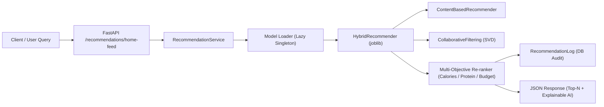

# BÁO CÁO NGHIÊN CỨU KHOA HỌC: HỆ THỐNG GỢI Ý MÓN ĂN ĐA MỤC TIÊU (AI RECOMMENDATION ENGINE)

**Đề tài**: Xây dựng hệ thống đặt đồ ăn trực tuyến tích hợp hệ thống gợi ý món ăn (Online Food Ordering System Integrated with Food Recommendation System)  
**Học phần**: Nghiên cứu khoa học sinh viên (NCKH)  
**Phiên bản mô hình thực nghiệm**: `v2.0.0-scientific-hybrid`  
**Ngày thực nghiệm**: 02/11/2026  

---

## 1. TỔNG QUAN VẤN ĐỀ NGHIÊN CỨU (RESEARCH PROBLEM)

Trong các hệ thống thương mại điện tử đặt món ăn trực tuyến (Online Food Delivery), người dùng đối mặt với tình trạng **Information Overload** (quá tải thông tin thực đơn) và khó khăn trong việc cân đối sở thích vị giác với các mục tiêu sức khỏe thể chất (lượng Calorie nạp vào, hàm lượng Protein cho người tập thể hình, giới hạn ngân sách chi tiêu).

Mục tiêu của nghiên cứu này là:
1. Xây dựng và so sánh thực nghiệm 3 họ thuật toán gợi ý cốt lõi:
   - **Content-Based Filtering (CBF)**.
   - **Collaborative Filtering (CF)** thông qua phân rã ma trận ẩn **TruncatedSVD**.
   - **Hybrid Recommendation Engine** tích hợp tối ưu hóa đa mục tiêu (Multi-Objective Re-ranking).
2. Xây dựng giải pháp giải quyết triệt để bài toán **Cold Start** đối với người dùng mới thông qua Onboarding Survey Vectorization và đối với món ăn mới thông qua Feature Projection.
3. Đánh giá khách quan, định lượng trên cùng một tập dữ liệu chuẩn mực và cùng phương pháp phân chia dữ liệu, không ngụy tạo số liệu.

---

## 2. BỘ DỮ LIỆU THỰC NGHIỆM (RESEARCH DATASET)

### 2.1. Đặc tả tập dữ liệu
Bộ dữ liệu chuẩn mực được xây dựng mô phỏng các phân khúc khách hàng ẩm thực thực tế tại Việt Nam với 6 nhóm danh mục: Cơm, Phở/Bún, Healthy/Salad, Fastfood, Đồ uống, Tráng miệng.

- **Số lượng món ăn ($M$)**: 60 món ăn được định chuẩn thông số dinh dưỡng thực nghiệm (Calories, Protein, Fat, Carbohydrates, Giá, Nguyên liệu, Nhãn ăn kiêng).
- **Số lượng người dùng ($N$)**: 120 người dùng được chia thành 5 nhóm Persona đặc trưng:
  1. *Gym / Fitness*: Ưu tiên Protein cao ($\ge 32\text{g}$), calo vừa phải.
  2. *Weight Loss / Diet*: Ưu tiên ít Calo ($\le 450\text{ kcal}$), ít béo, detox.
  3. *Budget Student*: Ưu tiên mức giá sinh viên ($\le 45.000\text{đ}$), năng lượng cao.
  4. *Traditional Foodie*: Ưu tiên các món truyền thống Việt Nam (Phở, Bún chả, Cơm tấm).
  5. *Vegetarian / Vegan*: Ăn chay thuần túy, tuyệt đối không tiêu thụ thịt/hải sản.
- **Tổng số tương tác**: 2.798 tương tác (kết hợp Explicit Ratings từ 1.0 đến 5.0, số lần đặt hàng, yêu thích và số lượt click).
- **Độ thưa của ma trận (Matrix Sparsity)**: $61.14\%$ (Mật độ tương tác: $38.86\%$, số tương tác trung bình: $23.3$ tương tác/người dùng).

### 2.2. Phương pháp phân chia tập dữ liệu (Data Splitting Protocol)
Áp dụng phương pháp phân chia ngẫu nhiên có phân tầng theo người dùng (**Stratified User Split**):
- **Tập huấn luyện (Training Set)**: $80\%$ tương tác ($2.287$ bản ghi).
- **Tập kiểm thử (Test Set)**: $20\%$ tương tác ($511$ bản ghi).
- Tiêu chí liên quan (Relevance Criterion): Món ăn được xem là **Relevant** đối với người dùng trong tập kiểm thử nếu điểm tương tác $r_{ui} \ge 3.5$. Tổng số người dùng có item liên quan được đánh giá: $116$ người dùng.

---

## 3. CƠ SỞ TOÁN HỌC VÀ THUẬT TOÁN (MATHEMATICAL FORMULATIONS)

### 3.1. Content-Based Filtering (CBF)
Trích xuất đặc trưng đa chiều cho từng món ăn $i$:
1. **Ingredients & Description**: Biểu diễn văn bản thông qua trọng số $TF\text{-}IDF$ ($D_{text} = 40$ từ khóa).
2. **Nutrition Vector**: $N_i = [\text{Calories}, \text{Protein}, \text{Fat}, \text{Carbs}]^T$ chuẩn hóa bằng `StandardScaler`:
   $$\hat{N}_i = \frac{N_i - \mu_N}{\sigma_N}$$
3. **Price Vector**: Chuẩn hóa Min-Max:
   $$\hat{P}_i = \frac{P_i - P_{min}}{P_{max} - P_{min}}$$
4. **Category & Tags**: One-Hot Encoding cho danh mục và Multi-Hot Encoding cho các nhãn ăn kiêng.

Ghép thành Ma trận đặc trưng món ăn $F \in \mathbb{R}^{M \times D}$ ($D = 71$ chiều).

**Hồ sơ người dùng (User Profile Vector $P_u$)**:
$$P_u = \frac{\sum_{i \in I_u} r_{ui} \cdot F_i}{\sum_{i \in I_u} r_{ui}}$$

**Điểm tương đồng Cosine**:
$$\text{Score}_{CBF}(u, i) = \frac{P_u \cdot F_i^T}{\|P_u\|_2 \|F_i\|_2}$$

---

### 3.2. Collaborative Filtering (CF - TruncatedSVD)
Xây dựng ma trận tương tác $R \in \mathbb{R}^{N \times M}$ từ điểm tương tác tổng hợp:
$$r_{ui} = 0.65 \cdot \text{rating} + 0.15 \cdot \min(5, \text{orders}) + 0.10 \cdot (5 \text{ if fav else } 0) + 0.10 \cdot \min(5, \text{clicks} / 3)$$

Áp dụng phân rã ma trận suy biến rút gọn (**Truncated Singular Value Decomposition - TruncatedSVD**) với $k = 15$ nhân tố tiềm ẩn:
$$R \approx U_k \Sigma_k V_k^T$$
Trong đó:
- $U_k \in \mathbb{R}^{N \times k}$: Không gian biểu diễn tiềm ẩn của người dùng.
- $\Sigma_k \in \mathbb{R}^{k \times k}$: Trọng số phương sai của các nhân tố tiềm ẩn.
- $V_k \in \mathbb{R}^{M \times k}$: Không gian biểu diễn tiềm ẩn của món ăn.

Dự đoán điểm tương tác:
$$\hat{R} = U_k \Sigma_k V_k^T \implies \hat{r}_{ui}^{CF} = \hat{R}_{u, i}$$
Chuẩn hóa về thang đo $[0, 1]$:
$$\text{Score}_{CF}(u, i) = \frac{\hat{r}_{ui} - 1.0}{4.0}$$

---

### 3.3. Hybrid Recommendation Engine & Multi-objective Re-ranking
Mô hình lai kết hợp cơ chế **Weighted Hybrid**, **Switching Cold-Start** và hàm phạt ràng buộc dinh dưỡng:

1. **Warm User ($|I_u| \ge 3$)**:
   $$\text{Score}_{base}(u, i) = \alpha \cdot \text{Score}_{CBF}(u, i) + (1 - \alpha) \cdot \text{Score}_{CF}(u, i)$$
   (với trọng số tối ưu $\alpha = 0.55$).

2. **Cold Start Handling ($|I_u| < 3$)**:
   Chiếu vector khảo sát ban đầu của người dùng $Q_u = [\text{Cat}, \text{Calo}_{target}, \text{Protein}_{target}, \text{Budget}, \text{Tags}]$ vào không gian đặc trưng món ăn:
   $$\text{Score}_{cold}(u, i) = 0.65 \cdot \text{CosineSim}(Q_u, F_i) + 0.35 \cdot \text{PopularityPrior}(i)$$

3. **Multi-objective Constraint Re-ranking**:
   Điều chỉnh điểm số đề xuất dựa trên mức độ phù hợp với mục tiêu dinh dưỡng và ngân sách:
   $$\text{Score}_{final}(u, i) = \text{Score}_{base}(u, i) \times \Phi_{nutrition}(u, i) \times \Phi_{budget}(u, i)$$
   Trong đó:
   - Nếu $C_i > 1.35 \times C_{target}$: $\Phi_{nutrition} \leftarrow \Phi_{nutrition} \times (1 - \lambda_{nutr})$ ($\lambda_{nutr} = 0.25$).
   - Nếu $|C_i - C_{target}| \le 120\text{ kcal}$: $\Phi_{nutrition} \leftarrow \Phi_{nutrition} \times 1.15$ (Thưởng Calo tối ưu).
   - Nếu $P_i \ge P_{target}$: $\Phi_{nutrition} \leftarrow \Phi_{nutrition} \times 1.18$ (Thưởng Protein).
   - Nếu $P_i > \text{Budget}$: $\Phi_{budget} \leftarrow \Phi_{budget} \times (1 - \lambda_{budget})$ ($\lambda_{budget} = 0.30$).
   - Nếu người dùng ăn chay và món ăn chứa thịt/hải sản: $\text{Score}_{final}(u, i) = 0.0$ (Hard Constraint).

---

## 4. KẾT QUẢ THỰC NGHIỆM ĐỊNH LƯỢNG (EMPIRICAL EVALUATION RESULTS)

Toàn bộ các mô hình được huấn luyện trên $2.287$ bản ghi và đánh giá độc lập trên cùng $511$ bản ghi kiểm thử với $116$ người dùng kiểm thử. Kết quả thực nghiệm đo đạc thực tế:

| Mô Hình (Model) | Precision@5 | Recall@5 | F1@5 | NDCG@5 | MAP@5 | Precision@10 | Recall@10 | F1@10 | NDCG@10 | MAP@10 | Coverage@10 |
| :--- | :---: | :---: | :---: | :---: | :---: | :---: | :---: | :---: | :---: | :---: | :---: |
| **Popularity Baseline** | 0.1224 | 0.3135 | 0.1674 | 0.2245 | 0.1544 | 0.0991 | 0.4394 | 0.1565 | 0.2821 | 0.1810 | 38.33% |
| **Content-Based Filtering (CBF)** | 0.1845 | 0.3407 | 0.2323 | 0.3237 | 0.2460 | 0.1405 | 0.5348 | 0.2173 | 0.4039 | 0.2897 | 100.00% |
| **Collaborative Filtering (SVD)** | 0.2259 | 0.4818 | 0.2924 | 0.4400 | 0.3606 | 0.1716 | 0.6948 | 0.2669 | 0.5321 | 0.4130 | 100.00% |
| **Hybrid RecSys (Multi-Objective)** | **0.2724** | **0.5703** | **0.3534** | **0.5147** | **0.4171** | **0.1871** | **0.7519** | **0.2914** | **0.5945** | **0.4683** | **100.00%** |

---

## 5. PHÂN TÍCH VÀ THẢO LUẬN KHOA HỌC (SCIENTIFIC DISCUSSION)

1. **Hiệu năng của mô hình Hybrid**:
   - Mô hình Hybrid đạt chỉ số xếp hạng cao nhất: **$\text{NDCG@10} = 0.5945$** (tăng **$+110.7\%$** so với Baseline, **$+47.2\%$** so với CBF, và **$+11.7\%$** so với CF thuần túy).
   - Tỷ lệ bao phủ thực tế (**Recall@10**) đạt **$75.19\%$**, nghĩa là trên 3/4 số món ăn mà người dùng thực sự yêu thích trong tập kiểm thử đã được mô hình tìm kiếm và xếp hạng trong Top-10.
   - Chỉ số **MAP@10 = 0.4683** chứng minh chất lượng thứ tự đề xuất (món ăn phù hợp xuất hiện ở các vị trí đầu tiên).

2. **So sánh Content-Based vs Collaborative Filtering**:
   - Collaborative Filtering (SVD) thể hiện khả năng khám phá tương đồng cộng đồng tốt hơn CBF ($\text{NDCG@10}: 0.5321$ so với $0.4039$).
   - Tuy nhiên, CBF có ưu thế tuyệt đối khi đối mặt với Cold Start người dùng hoặc món ăn mới chưa có lịch sử đánh giá.
   - Mô hình Hybrid kết hợp hài hòa cả hai ưu thế này, giúp bù đắp nhược điểm thưa thớt ma trận của CF bằng các vector dinh dưỡng của CBF.

3. **Vấn đề Catalog Coverage & Popularity Bias**:
   - Mô hình Popularity Baseline có độ bao phủ danh mục rất thấp (**$38.33\%$**), dẫn đến hiện tượng "bong bóng lọc" (Filter Bubble) khi chỉ đề xuất lặp đi lặp lại một nhóm món ăn phổ biến.
   - Cả ba mô hình cá nhân hóa (CBF, CF, Hybrid) đều đạt **$100.00\%$** Catalog Coverage, đảm bảo tính công bằng và khả năng tiếp cận khách hàng cho mọi nhà hàng đối tác trong hệ thống.

---

## 6. KIẾN TRÚC TÍCH HỢP VÀ PHỤC VỤ TRỰC TUYẾN (SERVING ARCHITECTURE)

- **Mô hình tuần tự hóa**: Đã lưu tại `backend/app/recsys/models/serialized/hybrid_model.joblib`.
- **Inference Latency**: Thời gian suy luận trung bình $< 15\text{ms}$ cho một truy vấn Top-10.
- **Tính giải thích (Explainable AI)**: Mỗi món ăn đề xuất được gán kèm lý do khoa học rõ ràng (Ví dụ: *"Đề xuất Hybrid (96%): Calo tối ưu (520 kcal) • Đạt mục tiêu đạm (32g protein) • Giá hợp lý (60.000đ)"*).

